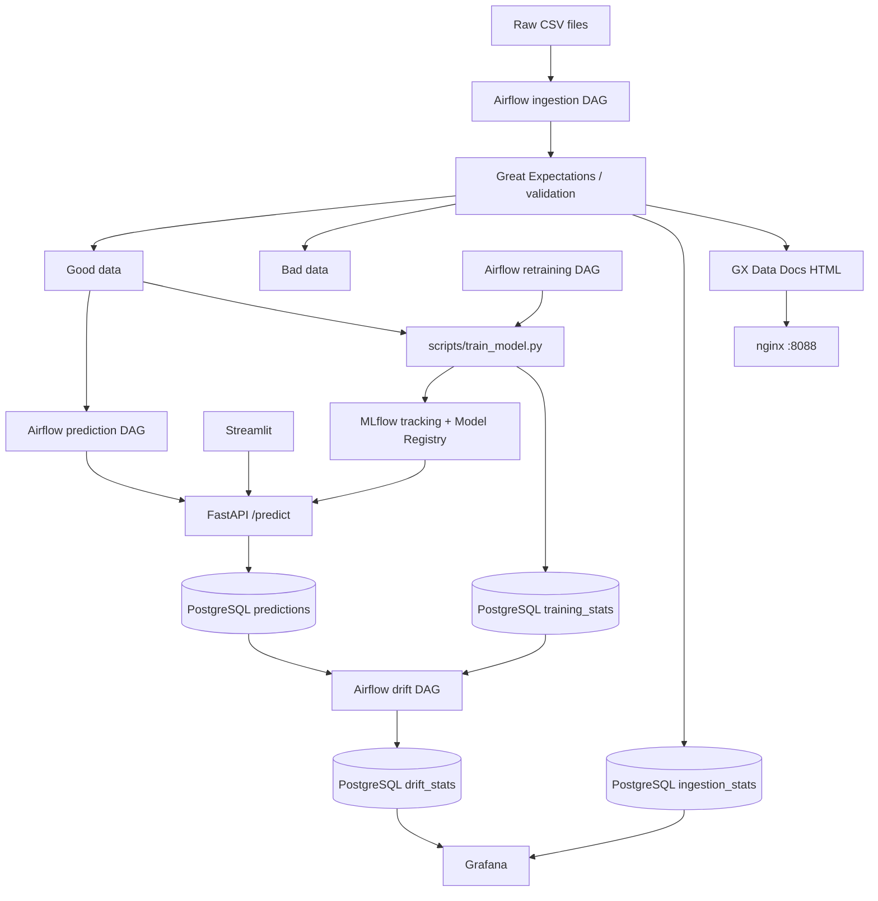

# Athlete Recovery Prediction — DSP MLOps Platform

An end-to-end ML application for predicting athlete recovery scores. This repository keeps the existing DSP 1 Athlete Recovery use case and extends it with MLflow tracking/model registration, scheduled retraining, model promotion, training statistics, PSI drift monitoring, Grafana, nginx-served Great Expectations Data Docs, and CI/CD.

> Use this as a DSP 2 implementation baseline. Run the smoke tests and validate all services on your machine before the defense; this generated configuration has not been exercised against your local Docker daemon.

## Architecture



## Services and local URLs

| Service | URL | Purpose |
|---|---|---|
| Streamlit | http://localhost:8501 | Single/batch predictions and history |
| FastAPI Swagger | http://localhost:8000/docs | Prediction and history API |
| Airflow 3 UI | http://localhost:8080 | Ingestion, scheduled prediction, training and drift DAGs |
| MLflow | http://localhost:5000 | Experiments, metrics, registered model and `champion` alias |
| Grafana | http://localhost:3000 | Data quality and feature drift dashboards |
| Great Expectations Data Docs | http://localhost:8088 | HTML validation report when generated |
| PostgreSQL | localhost:5432 | Application data, Airflow metadata DB and MLflow backend DB |

For local development only, defaults are Airflow `admin` / `admin` and Grafana `admin` / `admin`. Change them in `.env` before sharing or using outside your laptop.

## Start the project

Requirements: Docker Desktop with Compose v2 and sufficient memory for Airflow, PostgreSQL, MLflow and Grafana.

```bash
cp .env.example .env
# Edit passwords/secrets in .env before sharing the project.
docker compose config
docker compose up --build -d
docker compose ps
docker compose logs -f fastapi
```

The `db-bootstrap` one-shot service ensures `airflow_db` and `mlflow_db` exist even when you reuse a PostgreSQL volume from DSP 1. The initialization SQL also runs on a fresh volume. Avoid `docker compose down -v` unless you intentionally want to delete persisted database/model-tracking data.

## Data folders

- `data/clean/`: baseline labelled training dataset.
- `data/raw_data/`: new CSVs for ingestion.
- `data/good_data/`: validated rows eligible for scheduled scoring and retraining.
- `data/bad_data/`: rejected rows for inspection.
- `data/archived_data/`: validated data archived after successful scheduled retraining.

Place new CSVs in `data/raw_data/`. The ingestion DAG checks this folder every minute, validates rows, writes statistics to PostgreSQL, and splits valid/invalid records. The prediction DAG checks `good_data` every two minutes and sends JSON feature records to FastAPI with `source=scheduled`.

The committed clean synthetic dataset and compressed model artifact (`models/model.pkl.gz`) are provided so the app can start without needing an external download. The model is compressed to keep the artifact below GitHub’s 100 MB per-file limit. Do not commit `.env`, Airflow logs, generated reports, or the ignored `models/candidate_model.pkl.gz` training artifact. The small, compressed `models/model.pkl.gz` bootstrap model is intentionally included.

## Model lifecycle

1. `scripts/train_model.py` trains a preprocessing + Random Forest regression pipeline using labelled data from `data/clean/` and `data/good_data/`.
2. MLflow records parameters, MAE/RMSE/R², model artifact, and registers `AthleteRecoveryModel`.
3. A candidate is promoted to the MLflow `champion` alias if its RMSE is no worse than the current champion (or if no champion exists yet).
4. Feature summaries are written to `training_stats`.
5. FastAPI loads the champion model when available and falls back to `models/model.pkl.gz` until a registry model has been promoted.
6. `/reload-model` reloads the current champion without rebuilding the API container.
7. The drift DAG computes PSI for serving inputs versus training feature distributions and writes results to `drift_stats`. PSI >= `DRIFT_PSI_THRESHOLD` (default 0.2) is flagged as drift.

To run training manually inside the project container after the services are up:

```bash
docker compose exec airflow-scheduler bash -lc 'cd /opt/airflow/project && python scripts/train_model.py'
```

## API endpoints

| Endpoint | Method | Purpose |
|---|---|---|
| `/health` | GET | Readiness and active model version |
| `/predict` | POST | Single input object or `{ "features": [...], "source": "scheduled" }` batch JSON |
| `/batch-predict` | POST | Multipart CSV batch predictions; returns CSV |
| `/past-predictions` | GET | Supports `start_date`, `end_date`, `source=webapp|scheduled|all`, `limit` |
| `/reload-model` | POST | Reload MLflow `champion` model |
| `/monitoring/summary` | GET | Recent ingestion and drift summaries |

The UI never imports the model or connects directly to PostgreSQL; it calls FastAPI using HTTP requests.

## Monitoring

Grafana is provisioned with a PostgreSQL datasource and dashboard panels for ingestion volume, invalid-row percentage, recent criticality, and PSI feature drift. The dashboard reads `ingestion_stats` and `drift_stats`.

Great Expectations is configured under `gx/gx`. Run the validation page or `python validation/run_validation.py` from the repository root to execute the existing suite and update Data Docs. nginx serves the generated `gx/gx/uncommitted/data_docs/local_site` directory at http://localhost:8088.

## CI/CD and Git workflow

- `.github/workflows/ci.yml`: pull requests targeting `develop`; flake8 and pytest are separate jobs.
- `.github/workflows/cd.yml`: push to `main` creates a semantic patch release and GitHub Release with generated release notes.
- Use `main` for defense-ready code, `develop` for integration, and feature branches such as `feature/mlflow-training`.
- Do not commit directly to `main` or `develop`. Open PRs to `develop`, squash-merge, and merge `develop` into `main` before a defense.

## Tests

```bash
pip install -r requirements.txt
pip install flake8
pytest -q
flake8 api database scripts tests airflow/dags streamlit validation --count --show-source --statistics --select=E9,F63,F7,F82
```

The tests cover criticality thresholds, valid/invalid row splitting, ingestion statistics, Pydantic input validation, and PSI behavior. Integration tests should also be run with Docker before the defense.
